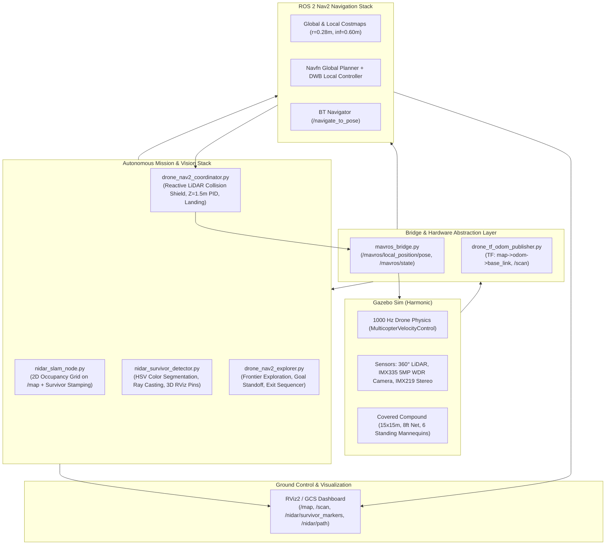

# 🚁 NIDAR AirMouse — Autonomous Indoor Search, Mapping & Survivor Tagging AI Drone

[](https://docs.ros.org/)
[](https://gazebosim.org/)
[](https://navigation.ros.org/)
[](https://github.com/mavlink/mavros)
[](https://opencv.org/)

An enterprise-grade, fully autonomous GPS-denied quadcopter system engineered for the **NIDAR AirMouse Challenge Brief (Track 1 — Drone Innovation: Search, Mapping & Survivor Localization in Covered Damaged Facilities)**.

---

## 🌟 Mission Overview & Core Capabilities

The NIDAR AirMouse drone executes end-to-end autonomous search and rescue missions inside a complex, covered, GPS-denied $15\text{ m} \times 15\text{ m}$ indoor maze:
1. **Autonomous Takeoff & Staging**: Lifts off from the designated Launch Helipad at $(X=-5.80, Y=-8.80)$, climbs to cruise altitude ($1.50\text{ m}$), and penetrates the compound through the 2.0-meter South Gate.
2. **Real-Time 2D SLAM Mapping (`/map`)**: Processes 360° LiDAR rays via Bresenham raycasting at 5 cm resolution, continuously constructing an occupancy grid of rooms, corridors, and debris.
3. **Autonomous Frontier Exploration**: Dynamically clusters boundary frontiers, plans optimal exploration paths using ROS 2 Nav2, and pushes targets away from obstacles with a $0.40\text{ m}$ standoff buffer.
4. **Active 360° LiDAR Reactive Collision Shield**: Continuous 30 Hz proximity monitor computes an inverse-distance repulsive velocity field. If any wall or corner approaches $< 0.35\text{ m}$, the coordinator triggers an instant **hard brake and pushback**, completely preventing collisions.
5. **Human / Survivor Detection & 2D Map Tagging**: Onboard computer vision node (`nidar_survivor_detector.py`) inspects the 5MP WDR camera feed (`/nidar/camera`) in real-time, segments International Rescue Orange suits and fluorescent yellow safety vests, projects pixel centroids to map coordinates, and tags them with persistent 3D pins and floating text labels (`Survivor #N (X, Y)`).
6. **Permanent 2D Map Etching**: Confirmed survivor coordinates are automatically stamped as occupied obstacles directly onto the `/map` SLAM grid.
7. **Autonomous Exit & Precision Touchdown**: Once all 6 survivors are found (or arena coverage reaches $\ge 85\%$), the explorer aborts search routines, plots an exit trajectory through the South Gate, returns to the Launch Helipad, descends softly at $-0.25\text{ m/s}$, cuts the motors, and disarms.

---

## 🏛️ System Architecture



---

## 🎯 Autonomous Survivor Search & Localization (6 Survivors)

The facility contains **6 realistic standing survivor mannequins** ($1.75\text{ m}$ tall, $0.48\text{ m}$ diameter) equipped with high-visibility International Rescue Orange suits and fluorescent yellow reflective safety vests, placed in unknown rooms throughout the grid.

- **Blind Autonomous Search**: The drone operates with zero prior knowledge of survivor locations and must discover all 6 survivors autonomously using its onboard sensors.
- **Multimodal Localization**:
  - **360° LiDAR**: Since the mannequins stand $1.75\text{ m}$ tall, the drone's horizontal LiDAR at flight altitude ($1.50\text{ m}$) strikes their torso and head directly, drawing them geometrically as obstacles on the 2D SLAM grid (`/map`).
  - **Onboard Vision**: The 5MP WDR camera detects the vibrant rescue orange and fluorescent yellow colors at eye level, estimating range and relative bearing.
- **Real-Time Tagging**: Once localized, each survivor is tagged on the map with persistent 3D pins and floating coordinate labels (`Survivor #N [X, Y]`), and permanently stamped into the 2D occupancy grid.

---

## 📡 Sensor Suite & ROS 2 Topic Architecture

| Hardware Component | Sensor Type | Primary Topic | Rate | Purpose |
| :--- | :--- | :--- | :--- | :--- |
| **Slamtec 360° LiDAR** | `gpu_lidar` | `/scan` & `/nidar/lidar` | 10 Hz | 2D SLAM mapping, Nav2 costmaps, reactive collision shield |
| **Waveshare IMX335 5MP WDR** | `camera` | `/nidar/camera` | 30 FPS | Primary survivor color segmentation & ray-cast localization |
| **Waveshare IMX219-83 Stereo** | `rgbd_camera` | `/nidar/stereo_camera/image` | 30 FPS | Auxiliary forward vision & 3D depth perception |
| **MAVROS 3D Drone Pose** | `geometry_msgs/PoseStamped` | `/mavros/local_position/pose` | 50 Hz | High-precision visual-inertial odometry & TF broadcast |
| **MAVROS Velocity Actuation**| `mavros_msgs/PositionTarget`| `/mavros/setpoint_raw/local` | 30 Hz | Body-frame velocity vector injection ($v_x, v_y, v_z, \omega_z$) |
| **2D SLAM Occupancy Grid** | `nav_msgs/OccupancyGrid` | `/map` | 5 Hz | Real-time 2D arena floor plan with survivor stamps |
| **Tagged Survivor Markers** | `visualization_msgs/MarkerArray` | `/nidar/survivor_markers` | 2 Hz | 3D colored pins and floating coordinate text in RViz |
| **Survivor Count** | `std_msgs/Int32` | `/nidar/survivor_count` | Event | Total confirmed survivors localized (0 to 6) |
| **Mission Completion** | `std_msgs/Bool` | `/nidar/mission_complete` | Event | Triggers return-to-home and gate exit sequence |
| **Emergency Landing Trigger** | `std_msgs/Bool` | `/nidar/land_command` | Event | Triggers coordinator precision touchdown over helipad |

---

## 📁 Repository Structure

```
├── config/
│   ├── nav2_drone_params.yaml    # Tuned Nav2 parameters (DWB controller, critics, costmaps)
│   ├── nidar_map.rviz            # Comprehensive RViz2 configuration (Map, TF, Path, Survivor Pins)
│   └── slam_toolbox_params.yaml  # Auxiliary SLAM Toolbox configuration
├── map/
│   ├── drone_nav2_coordinator.py # Active LiDAR collision shield, Z=1.5m PID, MAVROS velocity bridge
│   ├── drone_nav2_explorer.py    # Frontier exploration planner, standoff buffer, autonomous exit sequencer
│   ├── drone_tf_odom_publisher.py# TF tree broadcaster (map -> odom -> base_link -> lidar_link)
│   ├── mavros_bridge.py          # MAVROS state, pose, and offboard control bridge
│   ├── nidar_slam_node.py        # 2D Occupancy Grid SLAM node with survivor stamping
│   ├── nidar_survivor_detector.py# Real-time HSV color segmentation & 2D/3D map tagging node
│   ├── nidar_command_center.py   # Standalone manual HUD command center
│   └── wait_for_nav2.py          # Synchronous readiness check for Nav2 Action Server
├── worlds/
│   ├── nidar_drone_world.sdf     # 15x15m covered compound with 6 standing survivors & obstacles
│   └── quadcopter_stable.sdf     # Base Gazebo world template
├── run_sim.sh                    # Launches Gazebo Harmonic simulation world
├── run_nav2_autonomous.sh        # Single-command launcher for full autonomous stack + RViz
├── teleop_drone.py               # Lightweight keyboard teleoperation utility
└── README.md
```

---

## 🚀 Getting Started

### Prerequisites
- **OS**: Ubuntu 22.04 / 24.04 (native or WSL 2)
- **Simulator**: [Gazebo Harmonic](https://gazebosim.org/) (`gz-sim 10.x`)
- **ROS Version**: ROS 2 (Lyrical / Humble) with Nav2 & MAVROS packages installed:
  ```bash
  sudo apt update
  sudo apt install -y ros-lyrical-navigation2 ros-lyrical-nav2-bringup ros-lyrical-mavros ros-lyrical-visualization-msgs
  ```

---

### Step 1: Launch the Simulation World
In your first terminal:
```bash
cd ~/drone-sim
./run_sim.sh
```
*Gazebo Harmonic will launch with the $15\text{ m} \times 15\text{ m}$ covered compound and all 6 standing survivor mannequins. Click the **Play ▶** button at the bottom-left if paused.*

---

### Step 2: Launch the Full Autonomous Mission
In a second terminal:
```bash
cd ~/drone-sim
./run_nav2_autonomous.sh --rviz
```

The script orchestrates the entire operational pipeline automatically:
1. Starts the `mavros_bridge` and locks local position telemetry.
2. Broadcasts the TF transform tree (`map` $\to$ `odom` $\to$ `base_link` $\to$ `lidar_link`).
3. Starts the 2D SLAM node generating `/map` at 5 cm resolution.
4. Brings up the ROS 2 Nav2 stack (DWB local planner and Navfn global planner).
5. Opens RViz2 loaded with the preconfigured NIDAR monitoring layout.
6. Launches `nidar_survivor_detector.py` for real-time camera inspection.
7. Launches `drone_nav2_explorer.py` to begin frontier exploration.
8. Initiates autonomous takeoff to $1.50\text{ m}$ and engages the active collision shield.

---

## 🛡️ Collision Avoidance & Safety Features

* **Tuned DWB Critics**: `BaseObstacle.scale: 8.0` and `ObstacleFootprint.scale: 8.0` strongly penalize paths near corners, preventing clipping.
* **Corridor Centering**: Inflation radii of $0.55\text{ m}$ (local) and $0.60\text{ m}$ (global) guide trajectories along corridor centers.
* **Active 360° Reactive Collision Shield**:
  - Distance $< 0.52\text{ m}$: Calculates real-time repulsive pushback away from walls.
  - Distance $< 0.35\text{ m}$: Overrides Nav2 with an emergency brake and active reverse impulse (`🛡️ [COLLISION SHIELD] Wall at ...m! Repulsive pushback`).
* **Standoff Buffer**: Frontier goals are verified against the occupancy grid; targets within $0.35\text{ m}$ of a wall are automatically nudged $0.40\text{ m}$ into clear space.

---

## 🏁 Mission Completion & Autonomous Exit

When `survivor_count >= 6` or exploration coverage $\ge 85\%$:
1. The explorer cancels frontier tasks and transitions to `EXITING_MAZE`.
2. Plans a path through the South Gate interior corridor $(-5.80, -6.00)$.
3. Flies out through the gate to the Launch Helipad $(-5.80, -8.80)$.
4. Emits `/nidar/land_command`, causing the coordinator to execute a soft touchdown ($-0.25\text{ m/s}$), cut the motors, and report:
   ```
   🏁 [MISSION COMPLETE] Drone safely landed on helipad! Motors disarmed.
   ```

---

## 📜 License
Developed for the NIDAR AirMouse Challenge Brief. Distributed under the MIT License.
