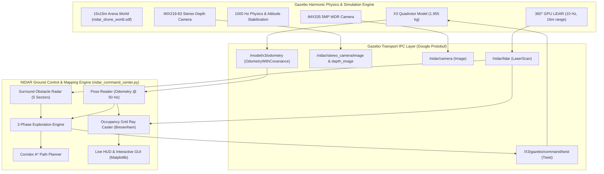
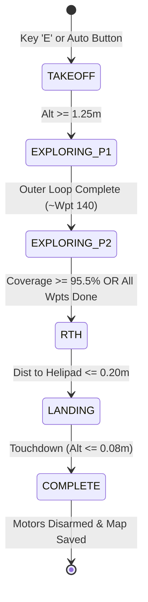

# NIDAR AI Drone — Simulation, Sensors & 2D Mapping Architecture Guide

This comprehensive reference document details the system architecture, mathematical models, sensor data pipelines, and algorithms powering the autonomous mapping and navigation system.

---

## 1. System Architecture Overview

The system operates via a dual-process architecture communicating over high-speed, local inter-process transport:



---

## 2. Simulation Environment (`nidar_drone_world.sdf`)

### 2.1 Arena Geometry & Spatial Bounds
- **Arena Dimensions**: $15.0\text{ m} \times 15.0\text{ m}$ enclosed compound ($[-7.50, +7.50]\text{ m}$ on both axes).
- **Floor**: High-traction ground plane with dark corridor tiles and designated start/landing helipad.
- **Ceiling**: Translucent overhead safety net frame capped strictly at $Z = 2.44\text{ m}$ (8 feet) with horizontal structural cross-ribs at $Z = 2.46\text{ m}$.
- **Wall Specifications**: 69 internal partition walls made of non-reflective concrete partitions ($0.08\text{ m}$ thickness, $2.44\text{ m}$ height).

### 2.2 4×4 Room Matrix & Corridor Highway Network
The compound consists of 16 rooms arranged in a 4×4 grid separated by $1.40\text{ m}$-wide corridor highways:

| Avenue / Axis | Coordinates ($X$ or $Y$) | Purpose |
| :--- | :--- | :--- |
| **Outer West Avenue** | $X = -6.80\text{ m}$ | West perimeter arterial highway |
| **Inner West Avenue** | $X = -3.40\text{ m}$ | Access to Rooms (0,1), (1,0), (1,2), (0,3) |
| **Center Spine Avenue** | $X = 0.00\text{ m}$ | Central arterial connecting north & south sectors |
| **Inner East Avenue** | $X = +3.40\text{ m}$ | Access to Rooms (3,0), (3,1), (2,2) |
| **Outer East Avenue** | $X = +6.80\text{ m}$ | East perimeter arterial highway |
| **Outer South Avenue** | $Y = -6.80\text{ m}$ | South perimeter corridor directly facing Helipad |
| **Inner South Avenue** | $Y = -3.40\text{ m}$ | Access to Room (2,0) and Room (1,1) South doorway |
| **Equator Avenue** | $Y = 0.00\text{ m}$ | East-West central cross-corridor |
| **Inner North Avenue** | $Y = +3.40\text{ m}$ | Access to Rooms (0,2), (3,2), (3,3) |
| **Outer North Avenue** | $Y = +6.80\text{ m}$ | North perimeter arterial highway |

---

## 3. Drone Hardware & Physical Data

The simulated platform is based on the **X3 UAV Quadrotor**, calibrated to realistic flight dynamics:

### 3.1 Physical & Inertial Parameters
- **Frame Type**: Quadrotor X-configuration
- **Total Flight Mass ($m$)**: $1.955\text{ kg}$ (including ~300g payload mounts)
- **Principal Inertias**:
  - $I_{xx} = 0.045\text{ kg}\cdot\text{m}^2$ (Roll inertia)
  - $I_{yy} = 0.085\text{ kg}\cdot\text{m}^2$ (Pitch inertia)
  - $I_{zz} = 0.115\text{ kg}\cdot\text{m}^2$ (Yaw inertia)
- **Body Bounding Box**: $0.47\text{ m} \times 0.47\text{ m} \times 0.16\text{ m}$
- **Takeoff Helipad Coordinates**: $X_0 = -5.10\text{ m}, Y_0 = -5.10\text{ m}, Z_0 = 0.053\text{ m}$ (Room 0,0)

### 3.2 Attitude Control & Physics Stabilization
Attitude stabilization is managed by Gazebo's native `MulticopterVelocityControl` plugin operating directly inside the ODE/Bullet physics engine at **1000 Hz**.
- Velocity command interface accepts body-frame linear and angular twist velocities:
  $$\mathbf{u} = \begin{bmatrix} v_x & v_y & v_z & \omega_z \end{bmatrix}^T$$
- Altitude Ceiling Limiter: Automatically clamps maximum climb target to $Z \le 2.30\text{ m}$ to guarantee clearance under the $2.44\text{ m}$ ceiling net.

---

## 4. Sensor Suite & Communication Pipeline

| Sensor | Device Type | Gazebo Topic | Update Rate | Specifications |
| :--- | :--- | :--- | :--- | :--- |
| **Item 1: LiDAR** | `gpu_lidar` (360° Horizontal) | `/nidar/lidar` | 10 Hz | 360 rays, range $0.15\text{m} \le r \le 16.0\text{m}$, resolution $0.01\text{m}$ |
| **Item 2: Stereo Vision** | `rgbd_camera` (IMX219-83) | `/nidar/stereo_camera/image`<br>`/nidar/stereo_camera/depth_image` | 30 FPS | $640 \times 480$ RGB, depth range $0.20\text{m} - 10.0\text{m}$, 83° FOV |
| **Item 3: WDR Camera** | `camera` (IMX335 5MP) | `/nidar/camera` | 30 FPS | $1920 \times 1080$ High-Res Color, 120° FOV, low-light sensitivity |
| **Odometry / Pose** | State Odometry | `/model/x3/odometry` | 50 Hz | Ground-truth 6-DOF position $(x, y, z)$ and orientation quaternion $(q_w, q_x, q_y, q_z)$ |

### 4.1 Native Gazebo Transport (No ROS Dependency)
Communication uses direct C-bindings to `gz-transport13` via Python ctypes / native protobuf decoders:
- Messages are published/subscribed without ROS bridge serialization overhead, maintaining latencies under $2\text{ ms}$.

---

## 5. Map Formation from Raw Sensor Data (Occupancy Grid Mapping)

The 2D map is constructed from scratch in real time using raw LiDAR distance readings combined with odometry pose estimates.

### 5.1 Coordinate Frame Transformations

```
Laser Sensor Frame (L)  -->  Drone Body Frame (B)  -->  World Frame (W)  -->  Grid Matrix Index (r, c)
```

1. **LiDAR Range-Bearing to Drone Local Frame**:
   The LiDAR sends an array of 360 range values $\{r_0, r_1, \dots, r_{359}\}$ spanning $[-\pi, +\pi]$:
   $$\theta_i = \theta_{\min} + i \cdot \Delta\theta, \quad \Delta\theta = \frac{2\pi}{360} = 1^\circ$$

2. **Local to Global World Coordinates**:
   Given the drone's estimated world pose $(x_d, y_d, \psi)$ where $\psi$ is yaw:
   $$\theta_{w, i} = \theta_i + \psi$$
   $$x_{ray, i} = x_d + r_i \cdot \cos(\theta_{w, i})$$
   $$y_{ray, i} = y_d + r_i \cdot \sin(\theta_{w, i})$$

3. **World Coordinates to Discrete Grid Cells**:
   The grid covers a $15.0\text{ m} \times 15.0\text{ m}$ area centered at the origin:
   $$c = \left\lfloor \frac{x + W/2}{\Delta s} \right\rfloor, \quad r = \left\lfloor \frac{H/2 - y}{\Delta s} \right\rfloor$$
   where $W = H = 15.0\text{ m}$, resolution $\Delta s = 0.05\text{ m}$ (5 cm/cell), resulting in a $300 \times 300$ cell matrix.

### 5.2 Ray Tracing via Bresenham's Line Algorithm
For each valid laser ray $(x_d, y_d) \rightarrow (x_{ray}, y_{ray})$:
- **Free Cells**: All cells traversed along the ray from the drone's position to $(x_{ray}, y_{ray})$ are cleared to `FREE` ($0$ / white):
  $$\text{grid}[r_{mid}, c_{mid}] = \text{FREE}$$
- **Occupied Cells**: If $r_i < r_{\max}$ (a physical wall or obstacle stopped the ray), the endpoint cell is marked `OCCUPIED` ($255$ / black):
  $$\text{grid}[r_{end}, c_{end}] = \text{OCCUPIED}$$
- **Unexplored Cells**: Cells not yet penetrated by any laser beam remain in the initial `UNKNOWN` ($128$ / grey) state.
- **Flight Path Tracking**: The cell containing the drone's current position is recorded as `PATH` ($200$ / blue trail).

```
   Raw LiDAR Ray Cast:
   [Drone (FREE)] -------- free space (Bresenham) --------> [Wall Endpoint (OCCUPIED)]
        |                                                            |
     cell=0                                                       cell=255
```

### 5.3 Surround Obstacle Radar Computation
In parallel with map updates, the raw 360° laser sweep is binned into 5 directional safety sectors relative to drone heading:

$$\theta_{rel} = (\theta_i + \pi) \pmod{2\pi} - \pi$$

| Sector | Angular Range ($\theta_{rel}$) | Purpose |
| :--- | :--- | :--- |
| **Front ($F$)** | $[-20^\circ, +20^\circ]$ | Forward collision avoidance & deceleration |
| **Front-Left ($FL$)** | $[+20^\circ, +60^\circ]$ | Corner entry detection |
| **Left ($L$)** | $[+60^\circ, +110^\circ]$ | Corridor wall lane-centering |
| **Front-Right ($FR$)** | $[-60^\circ, -20^\circ]$ | Corner entry detection |
| **Right ($R$)** | $[-110^\circ, -60^\circ]$ | Corridor wall lane-centering |

### 5.4 Live Arena Coverage Calculation
Coverage percentage evaluates how much of the $15\text{m} \times 15\text{m}$ arena has been surveyed:
$$\text{Coverage \%} = \frac{\sum \mathbb{I}(\text{cell} \neq \text{UNKNOWN})}{N_{\text{arena}}} \times 100\%$$
- **Target**: Reaches $\ge 95\text{–}96\%$ when all outer corridors, inner avenues, and all 16 room doorways have been swept.

---

## 6. Autonomous Mission Engine & Navigation



### 6.1 2-Phase Exploration Scheme
1. **Phase 1 (Rough Layout Estimation — Waypoints 0 to ~140)**:
   - Exits Room (0,0) via South doorway: `(-5.10, -5.80) -> (-5.10, -6.80)`.
   - Traverses the entire outer perimeter (South $\rightarrow$ West $\rightarrow$ North $\rightarrow$ East $\rightarrow$ South).
   - Maps the $15\times15\text{m}$ outer boundary and external room facades.

2. **Phase 2 (Deep Room Doorway Sweeps — Waypoints ~140 to 328)**:
   - Serpentine grid sweeps down internal avenues:
     - **Inner West ($X = -3.40$)**: Doorways of Rooms (1,0), (0,1), (1,2), (0,3).
     - **Center Spine ($X = 0.00$)**: Doorways of Rooms (1,3), (2,3), (1,2), (2,2), (1,1), (2,1).
     - **Inner East ($X = +3.40$)**: Doorways of Rooms (3,0), (3,1), (2,2).
     - **Crossways ($Y = +3.40, 0.00, -3.40$)**: Doorways of Rooms (3,2), (3,3), (0,2), (2,0), (1,1).
   - Passing within $0.70\text{ m}$ of each doorway allows the 16m LiDAR to penetrate deep into every room interior, eliminating all internal shadows.

### 6.2 Corridor Lane Centering & Dynamic Flight Control
- **Forward Cruise Speed**: Dynamically scaled based on distance to waypoint:
  $$v_x = \text{clip}(0.85 \cdot d_{wpt}, 0.35, 0.70)\text{ m/s}$$
- **Heading Alignment**: If heading error $|\Delta\psi| > 25^\circ$, the drone turns in place ($\omega_z = 1.6 \Delta\psi$) before accelerating forward.
- **Corridor Lane Centering**: Uses differential side LiDAR ranges $(s_L, s_R)$:
  $$v_y = \begin{cases} -0.20\text{ m/s} & \text{if } s_L < 0.50\text{ m and } s_L < s_R \text{ (Nudge Right)} \\ +0.20\text{ m/s} & \text{if } s_R < 0.50\text{ m and } s_R < s_L \text{ (Nudge Left)} \\ 0.0\text{ m/s} & \text{otherwise} \end{cases}$$
- **Stuck Watchdog**: If forward progress is blocked for $> 2.5\text{ s}$, the watchdog automatically increments the waypoint index to skip around the blockage and maintain continuous exploration.

### 6.3 Smart RTH (Return-To-Home) A* Router
When exploration completes ($\ge 95.5\%$):
1. Dilates all occupied wall cells by the drone's safety radius ($r_{safe} = 0.35\text{ m}$).
2. Computes the optimal collision-free shortest corridor path from current coordinates back to Home Helipad `(-5.10, -5.10)` using A* search.
3. Upon arriving over the helipad ($d \le 0.20\text{ m}$), initiates vertical descent ($v_z = -0.30\text{ m/s}$).
4. Once touching down ($Z \le 0.08\text{ m}$), disarms motors and exports `drone_map_final.png` and `drone_map_annotated.png`.

---

## 7. Execution Quick-Reference

```bash
# Terminal 1: Launch Gazebo Simulation World
gz sim -v 4 -r /home/dexter/Downloads/Drone-simulation-2-main/worlds/nidar_drone_world.sdf

# Terminal 2: Launch Autonomous Command Center
cd /home/dexter/Downloads/Drone-simulation-2-main/map
python3 nidar_command_center.py
```

- **Press `E`**: Start/pause autonomous 2-Phase exploration ($\ge 95\text{–}96\%$ coverage).
- **Press `H`**: Trigger immediate Smart Return-To-Home via shortest corridor route.
- **Press `Q`**: Terminate mission, disarm motors, and save high-resolution maps.
